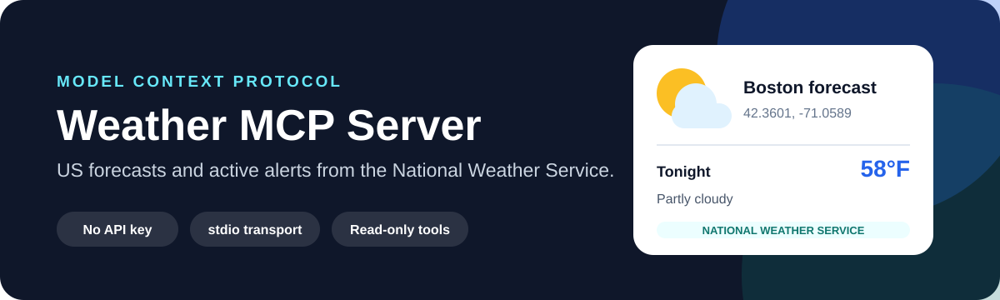

<p align="center">
  
</p>

# Weather MCP Server

<p>
  <a href="https://github.com/lukegeel101/weatherMCP/actions/workflows/ci.yml"></a>
  
  
  
</p>

A focused [Model Context Protocol](https://modelcontextprotocol.io/) server that gives compatible AI clients two US weather tools backed by the National Weather Service API.
It uses stdio, needs no weather API key, and performs no write actions.

## Tools

| Tool | Input | Result |
| --- | --- | --- |
| `get-forecast` | Latitude and longitude | NWS forecast periods with temperature, wind, and a short forecast |
| `get-alerts` | Two-letter US state or territory code | Active alerts with event, area, severity, status, and headline |

The National Weather Service grid API supports US locations only.

## Quick start

Requirements: Node.js 18 or newer.

```bash
npm ci
npm test
```

The build is written to `build/` and the executable entry point is `build/index.js`.

## Connect an MCP client

Build the project, then add an absolute path to your client's MCP configuration:

```json
{
  "mcpServers": {
    "weather": {
      "command": "node",
      "args": ["/absolute/path/to/weatherMCP/build/index.js"]
    }
  }
}
```

Restart the client after saving the configuration.
The server logs only lifecycle and request errors to stderr so MCP messages on stdout remain clean.

## Try it

```text
What is the forecast for Boston at 42.3601, -71.0589?
```

```text
Are there any active weather alerts in Massachusetts?
```

## Reliability and privacy

- Coordinates and state codes are sent only to `api.weather.gov` to satisfy the requested tool call.
- The server stores no user data and has no database.
- Request failures return a clear tool response instead of crashing the server.
- Forecast values preserve valid zero-degree temperatures.
- Tests use mocked responses plus an end-to-end stdio handshake and do not depend on live weather availability.

## Development

```bash
npm run build
node --test tests/*.test.mjs
```

CI builds and tests on Node.js 20 and 22, then confirms that the committed JavaScript matches the TypeScript source.

## Release

See [the v1.0.0 release notes](docs/releases/v1.0.0.md).
The package metadata exposes the `weather-mcp` binary, but this repository does not claim an npm publication.
